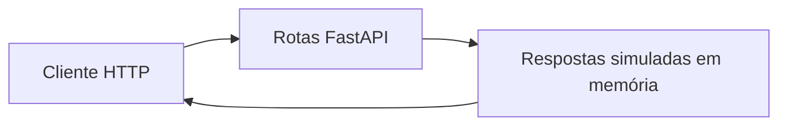

🇧🇷🧘

 | [](LICENSE) | [](https://github.com/sponsors/felipetjmg1-bit)

# Cristal de Quartzo Aurora — API Demonstrativa

## Visão geral

O README apresenta o projeto como infraestrutura brasileira de armazenamento óptico 5D em cristal de quartzo (Aurora v4.0 BR), com alegações de segurança, soberania de dados e aplicações bancárias/públicas. O que o código público permite verificar é mais restrito: uma pequena API FastAPI que simula ingestão, recuperação e status; não há implementação visível de gravação/leitura óptica ou armazenamento persistente em cristal.

## Objetivo e valor

**Problema/escopo:** API FastAPI de simulação para ingestão, recuperação e status no conceito de armazenamento Cristal de Quartzo Aurora.

**Valor verificável hoje:** o repositório torna explícitos seus artefatos, interfaces e limitações para que mantenedores e contribuidores possam avaliar o que existe sem confundir demonstração, proposta e produção.

## Arquitetura e tecnologias

Estrutura observável: README.md, requirements.txt e src/api/main.py. O módulo define a aplicação FastAPI, modelos Pydantic e três rotas HTTP: POST /ingest_data, POST /retrieve_data e GET /system_status. Não há camadas adicionais, persistência, hardware ou arquitetura de armazenamento físico documentados/implementados nos arquivos examinados; portanto, a arquitetura do sistema 5D alegado não está documentada no código público.



- Python (única linguagem indicada pela API de linguagens do GitHub).
- FastAPI 0.103.1, Uvicorn 0.23.2 e Pydantic 2.4.0, conforme requirements.txt.
- O README declara Python 3.11+ como pré-requisito; esse requisito não é configurado por manifesto de versão visível.

## Início rápido

Os comandos abaixo refletem instruções, manifestos ou pontos de entrada presentes no repositório. Dependências externas, segredos e serviços estão indicados quando aplicável; a presença de um comando não equivale a uma execução validada.

1. O README documenta clonar o repositório: git clone https://github.com/felipetjmg1-bit/cristal-quartzo-aurora.git && cd cristal-quartzo-aurora.
2. O README documenta instalar dependências com pip install -r requirements.txt.
3. O README documenta iniciar a API com uvicorn src.api.main:app --reload e indica a interface Swagger em http://localhost:8000/docs.
4. Estes são comandos documentados no README, não uma execução/teste independente desta auditoria. Não há comando de teste visível.


## Exemplo de uso

A API disponibiliza `GET /system_status`. Com o servidor local iniciado:

```bash
curl http://localhost:8000/system_status
```

A rota retorna valores definidos no código; não verifica hardware nem armazenamento físico.

## Estado e limitações

**Maturidade indicada:** Experimental.

- O endpoint de ingestão apenas verifica um prefixo para o nível bank_vault, calcula um hash e imprime uma mensagem; não grava dados. A recuperação também é explicitamente simulada e não retorna os dados enviados.
- Há aparente inconsistência na proteção de recuperação: o código procura a string bank_vault dentro do data_id, mas os IDs gerados são apenas aurora_data_ seguido do hash; portanto, a verificação de access_key não parece ser acionada para IDs gerados por ingestão.
- O status declara estabilidade térmica e imunidade eletromagnética em valores fixos no código, não medidos por sistema físico.
- Não apresentar os comandos do README como prova de execução ou a API como armazenamento óptico funcional; não inferir testes, segurança, persistência ou validação que não estejam demonstrados.

## Contribuição

Leia [CONTRIBUTING.md](CONTRIBUTING.md) antes de abrir uma issue ou pull request. Para reportes de segurança, siga a orientação específica do repositório, se houver.

## Licença

Este repositório está licenciado sob **MIT**; consulte [LICENSE](LICENSE).

## Patrocínio e apoio

O desenvolvimento aberto exige tempo para manutenção, documentação, testes, revisão de contribuições e resposta a issues. Se este projeto for útil, considere apoiar a continuidade pelo [GitHub Sponsors](https://github.com/sponsors/felipetjmg1-bit). O apoio não representa promessa de funcionalidades, prazo de entrega ou suporte comercial.

[](https://github.com/sponsors/felipetjmg1-bit)
